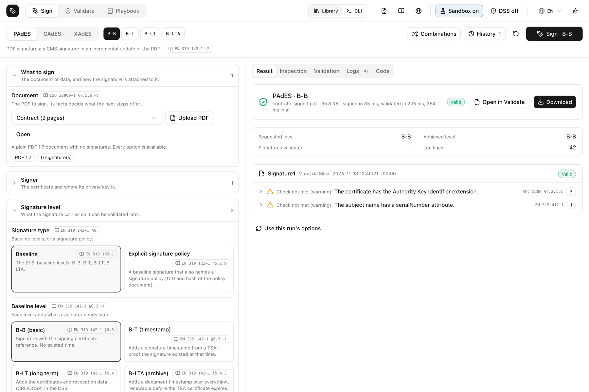
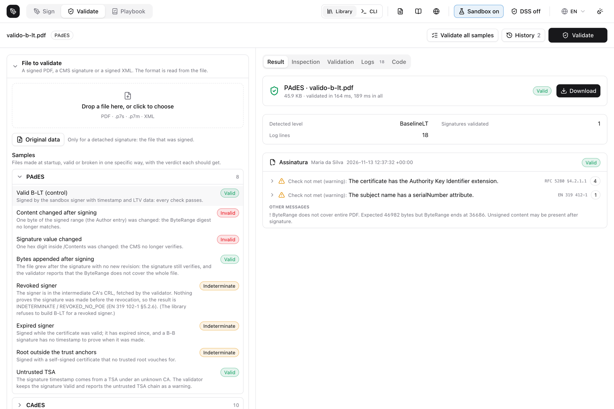
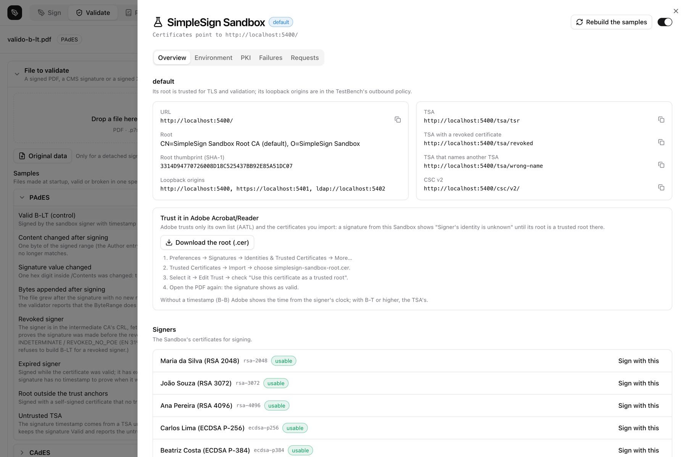
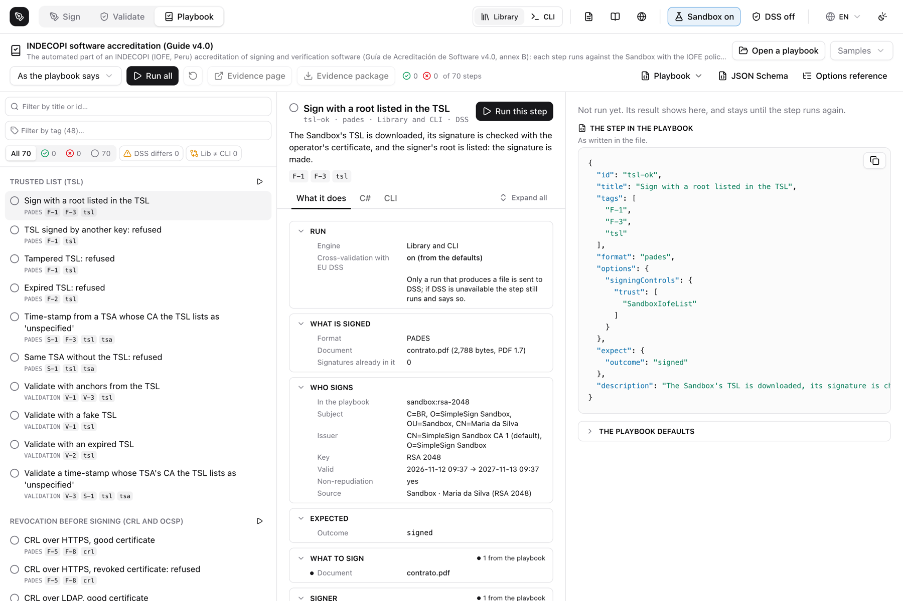

← [Back to README](https://github.com/eupassarin/simplesign#readme)

# The apps

SimpleSign is a library first, but four applications ship with it. None of them is required to use
the library; each exists because a different job is hard to do from code alone.

| App | What it is | Reach for it when |
|---|---|---|
| **[SimpleSign.Cli](cli.md)** | A `dotnet tool` named `simplesign` | You want to sign, validate, inspect or augment from a shell, a script or CI |
| **[SimpleSign.Agent](agent.md)** | A tray / menu-bar app with a local HTTP API | A web page has to sign with a certificate that lives on the user's machine — an A3 token or the OS store |
| **[SimpleSign.TestBench](testbench.md)** | A local web app for the three formats | You are choosing options, or you need to see what a standard actually requires and what a validator makes of it |
| **[SimpleSign.Sandbox](sandbox.md)** | A test PKI on real endpoints | You need CRLs, OCSP, a TSA and failures you can switch on, without touching a production PKI |

## How they fit together

Two combinations do most of the work.

**For an accreditation or a conformance run** — the TestBench, the Sandbox and a playbook. The
Sandbox gives you a PKI whose every edge case you can produce on demand (a revoked signer, an
expired TSA, a CRL without `nextUpdate`, a trusted list signed by the wrong key). The TestBench's
Playbook tab runs a list of steps written beforehand against it, through the library *and* through
the CLI, and exports the evidence as an HTML page and a zip. That is how
[INDECOPI's guide v4.0](iofe.md) and the [ETSI checklist](../playbooks/etsi-checklist.md) are
demonstrated. See [playbook.md](playbook.md).

**For signing in a browser** — the Agent. A web page cannot reach a smartcard or the OS certificate
store, so the Agent runs on the user's machine and the page calls it over loopback. The server keeps
the document and the policy; only the bytes to be signed cross the wire. That pairs naturally with
[two-phase signing](deferred-signing.md): the server prepares, the Agent signs, the server completes.

```
  your server ──prepare──▶ data to sign ──▶ browser ──▶ Agent (127.0.0.1:21590) ──▶ token / OS store
       ▲                                                       │
       └──────────────── raw signature ◀───────────────────────┘
                     complete() → the finished PAdES/CAdES/XAdES
```

The Sandbox is also useful on its own: the CLI and your own tests can point at it with
`--allow-origin http://localhost:5300`, and `tools/dss` makes a local EU DSS trust it so you can
cross-check verdicts.

## SimpleSign.Cli

```bash
dotnet tool install -g SimpleSign.Cli
```

The CLI targets **net8.0** and covers what the library does: `sign`, `sign-dir`, `validate`,
`validate-dir`, `inspect`, `extract`, `augment`, `deferred prepare|complete`, `cades`, `xades`,
`timestamp`, `policy`, `audit`, `pkcs11`, `psc`, `csc`, `fiscal`, `explain` and `html-to-pdf`.

```console
$ simplesign --help
USAGE:
    simplesign [OPTIONS] <COMMAND>

OPTIONS:
    -h, --help       Prints help information
    -v, --version    Prints version information

COMMANDS:
    sign <input>                Sign a PDF document
    sign-dir <directory>        Sign every PDF of a directory (batch)
    deferred                    Sign a PDF with a key that is elsewhere:
                                prepare, sign outside, complete
    augment <file>              Raise an existing signature (PDF, CMS or XML) to
                                B-T, B-LT or B-LTA
    validate <input>            Validate PDF signatures
    validate-dir <directory>    Validate all PDFs in a directory (bulk)
    inspect <input>             Inspect signature metadata (no validation)
    extract <input>             Extract CMS signatures from a signed PDF
    explain                     Explain PDF signature terms and fields
    html-to-pdf <input>         Convert an HTML file to PDF
    version                     Show version information
    cades
    timestamp
    pkcs11
    psc
    csc
    xades
    policy
    audit
    fiscal
```

Signing a PDF at B-LT against a Sandbox TSA, then validating it:

```console
$ simplesign sign contract.pdf --cert signer.pfx --password sandbox \
    --output contract-signed.pdf --ltv --tsa http://localhost:5400/tsa/tsr \
    --allow-origin http://localhost:5400
Signing...
✓ Signed: contract-signed.pdf
  Certificate: C=BR, O=SimpleSign Sandbox, OU=Sandbox, CN=Maria da Silva
  Timestamp:   http://localhost:5400/tsa/tsr
  LTV:         enabled
```

```console
$ simplesign validate contract-signed.pdf --trust root.pem --allow-origin http://localhost:5400
contract-signed.pdf  1/1 valid
├── Document
│   ├── Signatures: 1 user + 0 timestamps
│   ├── Encrypted:  No
│   ├── DocMDP:     Not locked
│   ├── PDF/A:      Not detected
│   └── ✓ DSS (embedded)
└── Signature1  ✓ VALID
    ├── Signer:       Maria da Silva
    ├── SubFilter:    ETSI.CAdES.detached
    ├── PAdES:        PAdES B-LT
    ├── Certificate
    │   ├── Issuer:         SimpleSign Sandbox CA 1 (default)
    │   ├── Key:            RSA 2048-bit
    │   ├── NonRepudiation: ✓
    │   └── Key Usage:      DigitalSignature, NonRepudiation
    ├── ESS CertV2:   ✓
    ├── Verification report
    │   ├── Indication:    TOTAL-PASSED (valid)
    │   └── Public key: RSA 2048 bits
```

Raising that signature to B-LTA later, with `--json` for a script:

```console
$ simplesign augment contract-signed.pdf --level BLTA \
    --tsa http://localhost:5400/tsa/tsr --allow-origin http://localhost:5400 --json
{"success":true,"format":"PAdES","initialLevel":"B-LT","level":"B-LTA",
 "output":"contract-signed.augmented.pdf","error":null}
```

Everything the CLI takes is in [cli.md](cli.md).

## SimpleSign.TestBench

```bash
dotnet run --project src/Apps/SimpleSign.TestBench
# → http://127.0.0.1:5199, loopback only
```

The TestBench is where you find out what an option *is*. Every control names the clause that defines
it (EN 319 142-1, 122-1, 132-1, 102-1, RFC 5652/3161/6960/5280, ISO 32000-1, XMLDSig) and the library
call it becomes, and the options the standards define but SimpleSign does not implement are shown
too, disabled. The **Library / CLI** switch at the top runs the same run through either engine, so
you can see where they differ.



Validation is the same screen for the three formats — the format is read from the file — and ships
with samples that are each broken in one specific way, with the verdict each should get:



The **Sandbox** button in the top bar is the Sandbox's user interface (the Sandbox itself is API
only). It shows the PKI, the endpoints, the signers, the failures you can switch on and a live
request log:



See [testbench.md](testbench.md). Node is needed to build its web bundle, but `dotnet build` runs
`npm ci` and `npm run build` for you.

## The Playbook tab

A playbook is a JSON file of steps, written beforehand, each tagged. The TestBench checks it against
the connected Sandbox, then runs one step, a section or all of them — through the library, the CLI
or both — and keeps each step's latest result. Before a step runs, the middle column shows
everything it will do: what is signed and by whom, every setting by group, the Sandbox changes, the
expectation, and the matching C# and CLI commands.



Three playbooks are bundled: `sandbox-basics`, `indecopi-guia-v4` (the automated part of INDECOPI's
accreditation guide, 70 steps) and `etsi-baseline` (115 steps covering the ETSI checklist). The
evidence export — an HTML page and a zip with every signed file, report and log — is what you hand
to an auditor. See [playbook.md](playbook.md) and [AUTHORING.md](../playbooks/AUTHORING.md).

## SimpleSign.Sandbox

```bash
dotnet run --project src/Apps/SimpleSign.Sandbox -- --ephemeral
# → http://localhost:5300, HTTPS on 5301, LDAP on 5302
```

A real PKI with real endpoints: AIA, CRLs over HTTP, HTTPS and LDAP, an RFC 3161 TSA, OCSP, a CSC v2
service and ETSI trusted lists (both the TS 119 612 layout and INDECOPI's TS 102 231 v3 one). What
makes it useful is everything it can get *wrong* on demand — a revoked signer or CA, an expired or
wrongly signed CRL, a CRL with no `nextUpdate`, a TSA that is down, slow, expired, revoked,
clock-shifted or misnamed, a trusted list that is expired, tampered with or signed by the wrong key.

`--ephemeral` builds a throwaway environment in a temp folder and deletes it on exit, which is what
CI uses; without it the environment is kept by name so the certificates and their URLs stay stable.
It is **API only** — its UI is the TestBench's Sandbox drawer, shown above.

See [sandbox.md](sandbox.md).

## SimpleSign.Agent

```bash
dotnet run --project src/Apps/SimpleSign.Agent
# → a menu-bar / tray app; its API is on http://127.0.0.1:21590 (loopback only)
```

The Agent is a small cross-platform desktop app (Avalonia; macOS, Windows, Linux, published with
Native AOT) that replaces the old Windows-only HostSigner. It exists so a web page can sign with a
key it cannot otherwise reach: an A3 token over PKCS#11, or a certificate in the operating system's
store.

Its window has an **Overview** (the agent's state, the certificates it can see and any problem with
them), **Sites** (which origins are authorized, and a way to revoke one), **Activity** (what has
been signed), **Test** (a real health → certificates → sign round trip through the consent dialog)
and **Documentation**, plus Settings and About panels. The tray menu shows the listening address and
lets you pause the agent, open the window, or quit.

Three endpoints:

```http
GET  /api/health          → { "status": "ok", "version": "0.11.0", "app": "SimpleSign Agent" }
GET  /api/certificates    → the usable certificates, filtered by country or trust framework
POST /api/sign            → signs one payload, after the user confirms
```

`GET /api/certificates?country=PE`, `?trust=icp-brasil`, `?trust=govbr` and `?signingOnly=true`
narrow the list to the certificates that chain to a registered country extension's anchors and are
usable for signing now; the chain is checked with `SigningCertificateCheck`, the same code path the
signers use, so a certificate the library would refuse is reported as such before the user is asked
for a PIN.

`POST /api/sign` only accepts what a signature is actually made of — DER CMS signed attributes, or a
canonical XML-DSig `SignedInfo`. Anything else (a raw hash, a whole document, bytes of some other
protocol) is refused with 400 **before** the user is asked to confirm, and the consent dialog shows
the digest being signed. That check is `DataToSignInspector`, which you can also call yourself.

Every signature needs the user's confirmation, every origin has to be authorized once, and the PIN
is asked by the app, never by the page. See [agent.md](agent.md).

> The screenshots above are of the TestBench. The Agent's window is not pictured here yet — see
> [agent.md](agent.md) for what each page holds.

## Which one do I need?

- **Signing in my own service, no UI** → none of them; use the library.
- **Signing from a script or CI** → the CLI.
- **Signing in a browser with the user's token** → the Agent, usually with
  [two-phase signing](deferred-signing.md).
- **Deciding which options to use, or reading what a standard requires** → the TestBench.
- **Testing revocation, timestamps or trusted lists without a production PKI** → the Sandbox.
- **Showing an auditor that it all works** → the TestBench's Playbook tab against the Sandbox.
