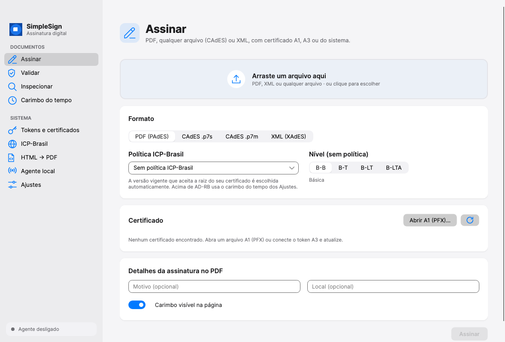
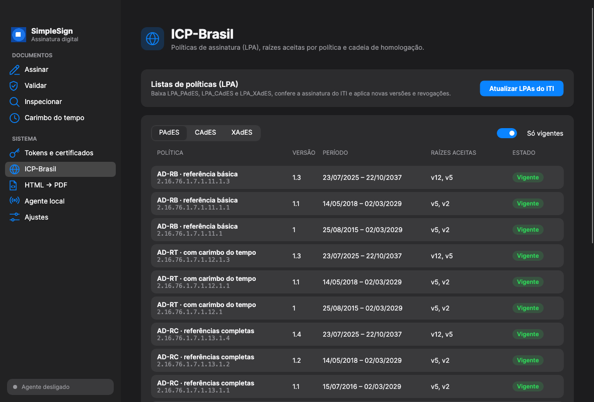
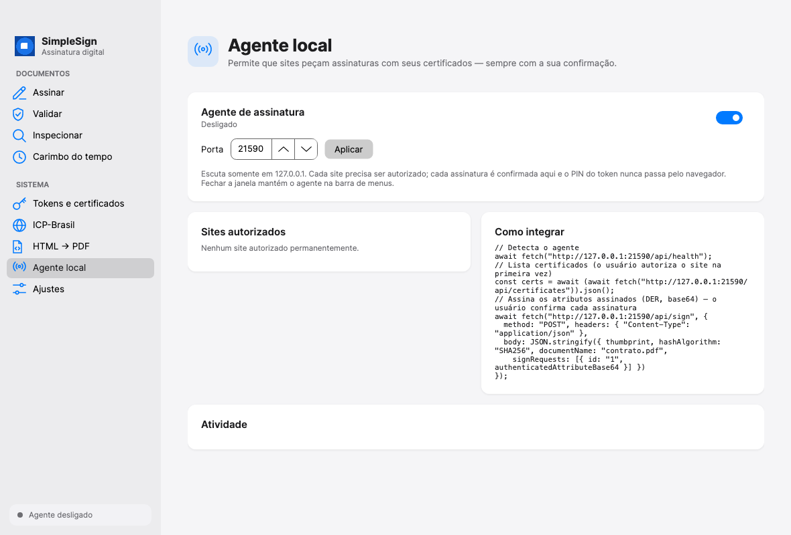

# SimpleSign Desktop and the signing agent

SimpleSign Desktop is a macOS, Windows and Linux app (Avalonia) that exercises the whole library
and runs the **local signing agent** web pages call to sign with the user's certificate: an A1
file, the OS certificate store or an **A3 token / smartcard** (PKCS#11). It replaces the former
Windows-only `SimpleSign.HostSigner`.



## Pages

| Page | What it does |
|------|--------------|
| **Assinar** | PDF (PAdES), any file (CAdES `.p7s` / `.p7m`) or XML (XAdES); B-B…B-LTA or an ICP-Brasil policy (AD-RB…AD-RA, picked by the signer's AC Raiz); PFX, OS store or token (PIN asked by the app); visible stamp. |
| **Validar** | Report per signature: integrity, signature, chain, revocation, timestamps, LTV, XAdES-C/X, Lei 14.063 level and the ICP-Brasil policy. |
| **Inspecionar** | PDF structure, revisions, DSS, certificates and timestamps; extract the CMS. |
| **Carimbo do tempo** | Create and verify standalone RFC 3161 timestamps (`.tst`), optionally requiring an ICP-Brasil ACT. |
| **Tokens e certificados** | Installed PKCS#11 drivers (`Pkcs11Drivers`), connected tokens and their certificates, PIN state. |
| **ICP-Brasil** | Policy catalog with accepted roots, LPA refresh (PAdES, CAdES, XAdES — signature verified), bundled roots, homologation mode. |
| **HTML → PDF** | Quick converter. |
| **Agente local** | On/off, port, authorized sites, activity log, integration example. |
| **Ajustes** | Default TSA/ACT, LCR cache, PIN cache, appearance. |



## The signing agent

The agent listens on **`http://127.0.0.1:21590`** only (configurable). Closing the window keeps it
running in the menu bar / tray; *Sair* stops it. The API keeps the former HostSigner contract, so
existing integrations work:

| Endpoint | |
|----------|---|
| `GET /api/health` | `{ "status": "ok", "version": "…", "app": "SimpleSign Desktop" }` — no permission needed. |
| `GET /api/certificates?source=all\|store\|pkcs11&filterIcpBrasil=true` | Store and token certificates (`source`, `tokenLabel` are new fields). |
| `POST /api/sign` | `{ thumbprint, hashAlgorithm, documentName?, signRequests: [{ id, authenticatedAttributeBase64 }] }` → `[{ id, signedHashBase64 }]`. The bytes are hashed with `hashAlgorithm` and signed (RSA PKCS#1 v1.5; ECDSA as IEEE P1363, as before). |

```js
await fetch("http://127.0.0.1:21590/api/health");
const certs = await (await fetch("http://127.0.0.1:21590/api/certificates")).json();
const [result] = await (await fetch("http://127.0.0.1:21590/api/sign", {
  method: "POST", headers: { "Content-Type": "application/json" },
  body: JSON.stringify({ thumbprint: certs[0].thumbprint, hashAlgorithm: "SHA256", documentName: "contrato.pdf",
    signRequests: [{ id: "1", authenticatedAttributeBase64 }] })
})).json();
```

Use it with [deferred signing](deferred-signing.md): the server prepares the signed attributes,
the browser asks the agent to sign them, the server completes the PDF.

### Security model

- **Loopback only**, request bodies limited to 1 MB, at most 100 items per request, 20 requests a minute per site.
- **Sites must be authorized.** The first time a site (exact `scheme://host[:port]`) lists
  certificates or asks for a signature, the app asks *“Permitir acesso aos certificados?”* —
  allow once, always (saved, removable on the Agent page) or deny. `null`, `file://` and other
  non-http(s) origins are refused. CORS echoes only the requesting site; Chrome's Private Network
  Access preflight is answered.
- **Every signature is confirmed** in the app, showing the site, the document name and the certificate.
- **The PIN never crosses the API.** Token PINs are typed in the app (or on the reader's PIN pad)
  and kept in memory only for the configured minutes (default: ask every time).
- The former `/api/sign-file`, `/api/inspect` and `/api/validate` endpoints, which took local
  file paths, were removed: they let any page that the user allowed act on arbitrary local files.
  Use the app's pages instead.



## Install and run

Download `SimpleSign-<version>-<rid>` from the GitHub release (macOS `.app` zip for Apple
silicon and Intel, Windows zip, Linux tarball). The builds are not code-signed yet: on macOS,
right-click → *Abrir* the first time; on Windows, *Mais informações* → *Executar assim mesmo*.

From source:

```bash
dotnet run --project src/SimpleSign.Desktop
scripts/package-desktop.sh osx-arm64 0.11.0      # SimpleSign.app in artifacts/desktop
```

## Migrating from SimpleSign.HostSigner

Same port and the same `/api/health`, `/api/certificates` and `/api/sign` contract. What changes
for users: each site is authorized once, and each signature is confirmed in the app. Token
certificates now appear in `/api/certificates` (`source: "pkcs11"`).
